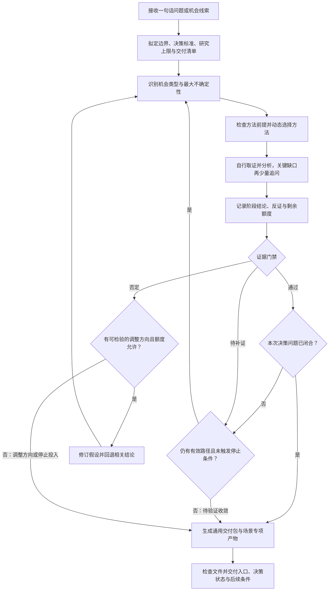

# 自适应方法论选择的商业机会研究 Skill｜需求文档

版本：v0.6 · 日期：2026-11-10 · 定位：首版需求，供 Skill 设计与实现使用。

Skill 英文标识：`business-opportunity-research`。

## 1. 目标与范围

建立一套根据**机会类型、研究阶段和当前最大不确定性**自主选择方法的研究 Skill，循环执行“选择方法 → 获取证据 → 形成阶段结论 → 校验 → 决定下一步”，最终输出商业机会分析报告和落地建议。

- 优先使用成熟、有实施流程和实践依据的方法；区分统计验证、管理实践与分析框架，不把广泛使用等同于科学证明。
- 支持从趋势线索、用户问题、技术变化或既有业务问题切入；允许跳过不适用阶段、组合方法、回退重研。
- 首版覆盖研究与验证方案设计；访谈、调查、实验和交易证据须真实获取。采购、投放、对外联系和发布按另行授权执行。

## 2. 输入与输出

| 类型 | 内容 |
| --- | --- |
| 启动必需 | 一句话描述的问题、想法或机会线索即可；无需先准备资料、选择方法或填写完整问卷 |
| 可选输入 | 已有资料、用户研究、经营数据、竞争信息、团队能力、预算、期限、可用工具与数据权限 |
| Skill 自行补充 | 从公开及已授权来源搜集市场、竞争、趋势、替代方案等证据；拟定研究目标、候选人群与范围，并标注待核实项 |
| 过程输出 | 机会假设、方法选择记录、证据台账、每轮结论、待验证问题与下一步动作 |
| 最终输出 | 通用交付包与按场景生成的专项产物，文件及位置见第 10 节；结论标记为“建议试点／调整方向／停止投入／待验证”，附证据索引与研究停止原因 |

### 低输入启动与渐进补充

研究所需信息按阶段逐步获取，不全部转化为用户的启动必填项：

- **可自行查得**：Skill 先搜集公开及已授权资料，不要求用户整理竞品、市场规模或方法论材料。来源不可访问时记录缺口。
- **可暂设或分情景分析**：研究边界、目标人群和成本区间等先提出工作假设；未知预算、资源和经营数据不得当作用户事实。
- **必须由用户或真实采集补充**：影响可执行性的个人／团队约束、内部经营数据，以及公开资料无法替代的访谈、问卷和实验结果。到相关决策节点再索取最小必要信息，并说明用途；已有授权来源能提供的直接读取。

每次最多集中询问 **3 个会实质改变决策的问题**；能先研究的部分继续推进。用户无法补充时，采用情景分析、降低结论强度或输出验证计划，不反复索要全套材料。

默认先做**公开资料初筛**，再按证据升级为定向评估或实证验证。只有一句宽泛想法时，先拟定目标与边界，选取 2～3 个候选方向做小范围探索；没有内部数据也可产出探索报告，但不对具体业务成效作已验证判断。

**一句话启动示例**：“我想找适合个人起步的小成本商业机会。”Skill 先给出简短研究任务摘要、自行查证并筛选方向；资源约束成为筛选瓶颈时，再询问可投入时间、预算或已有能力，无需用户预先确定行业、客群和商业模式。

### 提问原则与方法

结合**第一性原理式拆解、苏格拉底式提问和决策价值筛选**，作为研究辅助；它们不替代真实证据，也不构成固定的多轮问答流程。

- **第一性原理式拆解：识别真正缺口。** Skill 先将判断拆为目标、用户任务或价值机制、已核实事实、硬约束及待验证假设，找到会影响决策的关键缺口。保留已有研究和实践证据，不把直觉或未经核实的“底层规律”当作事实，也不要求用户先完成这种拆解。
- **苏格拉底式提问：按需澄清与检验。** 出现概念含糊、依据不足、前提冲突或忽略反例时，选择合适的问题澄清含义、核查依据、检查假设和替代解释。优先检查 Skill 自己的结论；对用户保持中立，不以辩倒对方或诱导同意为目标。
- **先判断是否值得问。** 只有合理的不同回答会改变研究方向、方案排序、行动边界或下一步验证，且无法从已有或可获取资料可靠解决时，才向用户提问。每个问题简要说明用途，不把可自行完成的研究工作转交用户。
- **少量、具体、容易回答。** 默认一次问 1 个问题，必要时最多集中问 3 个单一问题；不把多个子问题塞进一句。允许区间、近似值或“不清楚”；适合时给中立选项，避免预设答案。
- **优先具体经历和可核实记录。** 研究需求时询问最近发生的行为、现有做法和实际代价；“会不会购买”等意向回答只作线索，不当作付费证据。用户陈述仍需区分事实记录、估计和个人判断。
- **有停止条件。** 信息已足以支持下一步就停止追问；用户无法回答时，不重复索取，转为查证、情景分析或验证计划。涉及真实数据或行动授权的缺口，不能用默认假设替代。

下表是按需选用的问题示例，不要求逐项询问：

| 提问目的 | 示例 |
| --- | --- |
| 澄清含义与约束 | 你说的“小成本”，首轮试验预算大致在什么范围？这会影响候选方案的筛选。 |
| 核查依据 | 你判断用户愿意付费，主要依据已发生的交易、访谈反馈，还是目前的设想？ |
| 还原行为与替代方案 | 最近一次遇到这个问题时，你实际用了什么办法解决？ |
| 检查关键假设 | 这个方向是否依赖持续获得某类数据？目前能获取这类数据的依据是什么？ |
| 明确反证和停止条件 | 出现什么结果时，你会决定不再继续投入？ |

方法背景可参考[苏格拉底对概念与前提的检查](https://plato.stanford.edu/entries/plato-ethics-shorter/#Elen)及[批判性思考中的证据与替代观点](https://www.cmu.edu/teaching/solveproblem/strat-criticalthinking/criticalthinking-01.html)。以上分工、问题筛选规则和数量限制是本 Skill 的设计要求，不代表这些方法能单独证明商业机会成立。

## 3. Skill 组成与方法路由

采用“**研究调度器 + 方法卡库 + 证据台账 + 报告生成器**”。每张方法卡包含：方法来源与实践依据、适用／不适用条件、前置数据、执行步骤、产出格式、局限及校验条件。

调度器每轮先识别阻碍决策的最大不确定性，再按适配性、数据可得性、预期决策价值和成本选择 **1 个主方法，必要时加 1 个辅助方法**；记录选择理由、未选方法及阶段完成条件。

| 场景／关键问题 | 候选方法 | 预期产出与使用边界 |
| --- | --- | --- |
| 尚无明确机会，或外部变化影响不清 | 地平线扫描、情景分析 | 变化信号、影响机制与可检验假设；趋势不等于机会 |
| 用户为何行动、哪些结果未被满足 | JTBD（待完成任务）；ODI（结果驱动创新） | 任务情境、期望结果、需求细分；ODI 量化须有真实的重要度与满意度数据 |
| 技术替代、成本下降、供给重构 | 价值链分析、技术经济分析 | 价值转移、成本结构、采用障碍；无需强制经过 JTBD |
| 政策或跨地区差异带来机会 | 制度分析、市场准入研究、情景分析 | 适用边界、进入条件、风险与待核实事项 |
| 市场能否进入并盈利 | 自下而上市场测算、五力模型、单位经济模型 | 可触达市场、竞争结构、收益与成本区间；列明口径、假设和敏感性 |
| 如何设计并验证可行方案 | 价值主张设计、商业模式画布、假设驱动实验、精益创业 | 方案候选、关键假设、最小验证实验；有适当样本与实验条件时再用 A/B 测试或因果推断 |

JTBD 用于探索用户情境、动机与任务；若技术、供给或政策机会的判断不依赖用户任务机制，可跳过。ODI 须先明确目标人群、任务和期望结果，并取得适配研究问题的真实调查样本；前提不足时保留定性假设，不以定性材料代替量化。

方法库按需扩展，不要求依次执行表中所有方法。若无方法满足前置条件，先补证或报告限制，不强行套用。

## 4. 常见使用场景

适合需要分阶段消除不确定性、再决定是否投入的商业问题；既可完整研究，也可从已有证据所在阶段切入。

| 使用场景 | 典型问法 | 预期产出 |
| --- | --- | --- |
| 验证新想法 | 我想给小型商家做一个运营工具，值得做吗？ | 目标人群、真实问题、替代方案、商业假设与最小验证计划 |
| 发现未满足需求 | 这个品类产品很多，还有哪些需求没被满足？ | 用户任务、需求缺口、细分人群与机会优先级 |
| 从趋势寻找机会 | 人口结构或消费习惯变化，会产生哪些商业机会？ | 变化证据、影响机制、机会候选与验证路径 |
| 判断技术与成本变化 | 某项技术让交付成本下降，能形成什么新业务？ | 价值链变化、成本模型、可行方案与盈利条件 |
| 评估跨地区或跨渠道机会 | 一个模式在其他市场成立，能否复制到目标市场？ | 需求差异、竞争、进入条件、渠道成本与本地验证方案 |
| 比较多个业务方向 | 这三个方向，在我们的资源条件下应该先做哪个？ | 使用一致口径的比较、关键风险与优先验证顺序 |
| 诊断已有业务问题 | 用户有兴趣，但付费或复购很低，问题在哪里？ | 原因假设、证据缺口、排查顺序与改善实验 |
| 复盘试点并决定下一步 | 试点已经跑完，该扩大、调整还是停止？ | 实验结果判断、单位经济分析与下一阶段行动建议 |

上述场景是研究入口，不是固定流程模板。若只有公开资料，可完成机会初筛和验证设计；用户付费意愿、实际效果与盈利结论仍需真实调查、行为或交易证据。

## 5. 典型方法链路示例

以下展示跨轮次的可能路径；每个箭头均须结合当前证据重新判断，阶段间执行证据门禁。可跳过已有充分证据的阶段，也可因反证回退，不默认执行完整链路。各链路的成果按第 10 节保存，不只在聊天中展示结论。

### 示例一：用户需求缺口

- **输入**：某类产品的用户经常抱怨使用麻烦，想找出值得改进的机会。
- **可能链路**：资料与用户研究 → JTBD 识别情境、任务及替代行为 → ODI 量化期望结果的重要度与满意度 → 需求细分与机会排序 → 市场和单位经济分析 → 价值主张与最小验证实验。
- **分支条件**：人群、任务、期望结果未明确，或缺乏适配的真实调查样本时，先补充定性研究，暂不执行 ODI 量化；无法补证则保留假设并输出验证计划。
- **输出**：优先需求、目标人群、方案候选和试点建议；高机会评分不直接等同于产品可盈利。

### 示例二：新技术带来成本下降

- **输入**：新技术可能降低某项服务的交付成本，想判断是否值得进入。
- **可能链路**：核验技术能力与成本变化 → 技术经济分析 → 价值链分析 → 竞争与市场进入评估 → 单位经济及敏感性分析 → 小规模交付与交易验证方案。
- **分支条件**：若主要不确定性是成本与供给结构，可跳过 JTBD；若购买动机或采用障碍成为瓶颈，再转入用户任务研究。成本下降不能覆盖集成、获客或交付成本时，调整方案或停止。
- **输出**：可进入环节、成本与盈利条件、采用障碍、试点预算及停止阈值。

### 示例三：已有试点是否扩大

- **输入**：已有试点的使用、转化、付费和成本数据，需要决定下一步投入。
- **渐进补充**：用户只说“帮我复盘试点”也可启动；先识别试点目标和需要的最小指标，再读取授权数据或请用户补充。缺少数据时输出复盘框架和补证计划。
- **可能链路**：复核原假设、预设阈值和数据质量 → 分析真实行为及交易结果 → 条件满足时用 A/B 测试或因果推断判断增量效果 → 单位经济与交付能力分析 → 精益创业式迭代决策。
- **分支条件**：样本、对照或观察周期不足时补充验证，不宣称因果效果；结果好但经济性或交付能力不足时调整，核心假设被否定时停止或回退。
- **输出**：扩大、调整、停止或待验证的建议，附依据、资源条件和下一次决策节点。

## 6. 证据门禁

每轮必须形成阶段结论后再校验。门禁结果为“**通过／待补证／否定**”；通过后可推进，待补证时补充资料或更换方法，否定时调整假设或终止。以下为本 Skill 的治理规则，不是方法论共同规定的标准。

| 门禁 | 最低要求 |
| --- | --- |
| 可追溯 | 关键结论关联证据编号；保留来源链接或文件位置、发布日期／采集时间、原始摘录或数据、适用对象与范围 |
| 可信且适用 | 优先原始、近期、与目标场景匹配的证据；关键判断交叉核验，转载不算独立来源。仅有单一来源时说明原因与局限 |
| 事实与推断分离 | 区分事实、推断、假设；AI 生成内容不充当访谈、问卷、支付或实验结果，不编造 ODI 分数或成功概率 |
| 量化可复核 | 保留样本来源、规模、采样方式、计算口径、公式与关键假设；样本不足时仅作探索性判断，不外推总体 |
| 反证可见 | 主动检查替代解释、矛盾证据与失败条件；冲突未解时降低置信程度并阻止相关结论升级 |
| 建议与证据匹配 | 需求、可行性和商业性分别校验；缺少行为或交易证据时，建议以验证为主，不宣称商业模式已成立 |

置信程度使用高／中／低并说明依据，不把主观打分包装为统计概率。阶段完成条件及实验成败阈值应事先定义，避免看到结果后改标准。

## 7. 迭代与收敛机制

每轮固定记录：**当前问题 → 假设 → 所选方法与理由 → 新证据／反证 → 阶段结论与置信程度 → 门禁结果 → 下一步**。下一轮以更新后的结论和缺口为输入，重新路由；新反证影响上游假设时，回退并标记依赖结论失效。

- **继续**：仍有影响决策的缺口，且存在预算内、可获得的有效补证路径。
- **完成**：需求或价值机制、可行性、商业性已达到本次决策所需的证据要求，能够提出有边界的行动建议。
- **调整或停止**：核心假设被否定、经济性不成立、关键限制无法解决，或继续研究的预期价值不足。
- **待验证收敛**：证据无法获取、预算／期限耗尽，或连续无增量；输出已有发现与补证计划，不标记为验证成功。

首版建议默认最多 **6 轮**、连续 **2 轮**无决策相关新证据则停止；可由用户配置，期限和预算上限优先。每轮保存上述记录和剩余额度，续跑时复核证据时效与假设状态，复用仍有效的结果。

## 8. 整体流程



## 9. 最终报告结构

主报告采用以下通用骨架，其中决策摘要、研究范围与方法、证据与不确定性、行动建议为必选内容；需求和市场分析按当前问题裁剪，跳过时简述原因。不同场景使用对应标题和分析重点，避免为凑齐模板填充无关章节。

1. **决策摘要**：核心机会、建议状态、置信程度、适用边界与停止原因。
2. **研究范围与方法**：研究问题、输入、方法选择与跳过理由、迭代摘要。
3. **机会与需求分析**：变化机制、目标对象、任务或价值缺口、替代方案。
4. **市场与商业性**：市场测算、竞争、进入条件、单位经济模型及敏感性。
5. **证据与不确定性**：已证实／未证实事项、反证、数据局限、证据索引。
6. **落地建议与验证计划**：下一步动作与适用条件，链接独立行动计划；计划列明负责人角色、时间、资源／预算、成功与停止阈值、下一次决策节点，未知项标为待定。

## 10. 产出物与保存位置

### 统一保存规则

- **默认产出位置**：`<当前目录>/.bor/<研究主题>/`，记为本次的 `{RUN_DIR}`。用户明确指定其他输出位置时优先采用其指定位置；否则直接按主题保存，不为目录选择额外追问。
- **当前目录定义**：调用 Skill 时的当前工作目录。启动时解析为绝对路径并记录，本次研究期间保持固定，不随工具临时切换目录而改变；无法确定或不可写时按下述任务目录回退规则处理。
- **研究主题命名**：由用户给定主题或从研究问题提炼简短目录名，允许中文；移除路径分隔符等无效字符，保持产物位于 `.bor/` 内。研究产物与 Skill 安装目录分离。
- **续跑与重名**：继续同一研究时复用主题目录，追加轮次记录，并更新主报告、行动计划及交付索引；历史轮次保留。新建独立研究时，若主题目录已存在，则追加简短区分词或序号（如 `<研究主题>-2`），不覆盖原研究。通过用户给定路径或当前任务记录定位续跑目标；无法唯一识别时用一个问题确认。
- **启动时说明**：在简短研究任务摘要中列出识别的场景、计划交付物、证据阶段及保存位置。新增或更换场景时同步调整清单。
- **交付时说明**：只链接实际已生成且可读取的文件，给出主入口、主报告、行动计划的绝对路径或下载链接；文件名和正文中的链接须对应真实位置。默认目录不可用时使用当前环境可写且可下载的任务目录，并明确告知实际位置。

```text
<当前目录>/.bor/<研究主题>/    # {RUN_DIR}
├── README.md              # 交付入口与文件清单
├── report.md              # 按场景组织的主报告
├── action-plan.md         # 落地或补证行动计划
├── evidence.csv           # 证据索引与适用范围
├── research-log.md        # 每轮结论、门禁、改道与续跑信息
├── artifacts/             # 当前场景实际需要的专项产物
└── sources/               # 按需保存的原始材料或计算输入
```

### 通用交付包

| 文件 | 最低内容 |
| --- | --- |
| `README.md` | 研究问题、实际场景、更新时间、证据阶段、决策状态、停止原因，以及各产物的相对链接和“完成／部分完成／跳过”状态；未生成项只说明原因，不提供空链接 |
| `report.md` | 第 9 节要求的主报告；标明已证实、推断和待验证事项，关键结论关联证据编号 |
| `action-plan.md` | 按优先级列行动、目的、负责人角色、时间、资源、前置证据、成功／停止标准与下一决策点；探索阶段以补证和试点为主，终止时说明停止及重启条件 |
| `evidence.csv` | 证据编号、来源链接或文件位置、日期、摘录或数据定位、适用对象、对应结论、证据局限与冲突；没有可用证据时保留表头，并在报告中说明缺口 |
| `research-log.md` | 各轮问题、方法选择理由、新证据、结论、门禁、失效结论、下一步及剩余额度；记录用户补充和工作假设，支持续跑 |

通用包在正常结束、待验证收敛或因反证停止时均须交付。默认使用 Markdown 和 CSV；只有用户需要或分析确有必要时增加电子表格、图表等格式。`sources/` 按需保存可获取的材料，已有输入可引用原位置；不以空目录或空文件代替已完成研究。

### 不同场景的专项产物

以下文件均相对 `{RUN_DIR}`。仅生成本次场景所需产物；混合场景可组合，并在交付索引中说明各自产生的决策价值。

| 场景 | 专项产物 | 应回答的关键问题 |
| --- | --- | --- |
| 验证新想法 | `artifacts/idea-validation.md`：想法验证清单 | 为谁解决什么问题、现有替代是什么、哪些假设成立或待验证、下一步是否值得试点 |
| 发现未满足需求 | `artifacts/needs-map.md`：任务与需求地图；满足量化前提时增加 `artifacts/odi-results.csv` | 哪些情境和任务存在缺口、哪些期望结果优先；量化结果须附真实样本及计算依据 |
| 从趋势寻找机会 | `artifacts/opportunity-map.md`：信号与机会地图 | 哪个变化影响谁、通过什么机制形成机会、候选方向与反证是什么 |
| 判断技术与成本变化 | `artifacts/value-chain.md`：价值链分析；`artifacts/economics-model.csv`：成本与收益测算 | 价值转移到哪里、成本是否真实下降、包含集成／获客／交付后能否盈利；变量须有单位、来源和假设标记，公式及敏感性说明写入报告 |
| 评估跨地区或跨渠道机会 | `artifacts/entry-assessment.md`：进入评估 | 原市场经验能否迁移、需求和竞争有何差异、进入条件与本地试验是什么 |
| 比较多个业务方向 | `artifacts/opportunity-comparison.csv`：机会对比表 | 各方向在一致口径下的收益、成本、资源、风险、证据强度如何，先验证哪个；评分与权重如使用须解释依据 |
| 诊断已有业务问题 | `artifacts/diagnosis.md`：问题诊断与排查清单 | 哪个指标异常、有哪些竞争性原因假设、依据与排查顺序是什么；未验证的原因不得写为确定根因 |
| 复盘试点并决定下一步 | `artifacts/pilot-review.md`：试点复盘 | 是否达到预设阈值、效果和经济性证据是否充分、扩大／调整／停止各需什么条件 |

### 证据阶段与交付深度

- **公开资料初筛**：交付候选机会、假设、已有依据、风险和验证计划，专项产物标为初步版本；不填造调查分数、实验效果或真实利润。
- **定量评估**：具备适配的调查、经营或可追溯公开数据后，增加评分、对比或经济测算；保留输入、口径、公式说明和不确定性。公开数据只能支持其适用范围内的测算，不替代特定人群的调查或具体业务的真实业绩。
- **实证复盘**：具备真实行为、交易或实验数据后，交付结果判断与有边界的行动建议；因果主张仍须满足相应识别条件。

证据不足不取消交付：报告与行动计划必须写出缺口和最小补证路径，所需专项文件可只呈现已有发现及待验证事项；依赖缺失数据的量化文件不生成。交付完成度与商业机会是否被验证成立分别记录。

## 11. 后续 Skill 内容要求

- Skill 源码目录使用 `skills/business-opportunity-research/`，`SKILL.md` 的 frontmatter `name` 为 `business-opportunity-research`，与目录名一致。
- 实现 Skill 时，必须纳入第 4 节的 **8 类常见场景**和第 5 节的 **3 条方法链路示例**，作为使用说明、路由参考与验收依据。
- `SKILL.md` 保留适用场景、中英文触发词、动态路由原则及典型链路摘要；完整示例可存放于 `{SKILL_ROOT}/examples/scenarios.md`，由 `SKILL.md` 明确引用，并要求识别场景时按需读取。
- 每个完整示例包含：典型输入、关键不确定性、方法选择理由、数据前提、阶段产出、门禁、补证／回退／停止分支。示例不得被实现为不考虑证据的固定串行流程。
- Skill 首次使用或用户询问如何使用时，展示场景与提问示例；收到具体研究任务后直接按实际输入判断路径，不强制用户先选择场景编号。
- 必须将第 2 节的低输入启动、主动取证、渐进追问及证据不足时的降级规则写入 `SKILL.md`；示例同时展示一句话启动和资料较完整时的用法。
- 必须将提问原则写入 `SKILL.md`：先拆解事实与假设，再判断问题的决策价值，按需使用苏格拉底式提问；附中立问法、问题数量限制及停止追问规则，禁止执行固定的长问卷。
- 必须将第 10 节的目录规则、通用交付包、场景到专项产物的映射、证据阶段与交付检查写入 Skill；可拆为输出说明和场景模板，由 `SKILL.md` 使用 `{SKILL_ROOT}` 引用并明确加载时机。启动时选定交付清单，结束时核对文件、链接和状态。

## 12. 首版验收标准

- 同一 Skill 能处理“用户需求缺口”和“技术成本变化”两类输入，展示不同路由及其理由。
- 每轮有结构化结论及门禁结果，所有关键结论可追溯；证据不足时输出待验证状态。
- 能演示反证导致回退、无增量或额度耗尽导致收敛，以及保存记录后的续跑。
- 最终报告保留必选内容并按场景裁剪分析章节，建议与证据强度一致，Mermaid 流程可渲染，文档可独立阅读。
- Skill 包含 8 类场景与 3 条链路示例，入口可发现并可按需加载；三个示例均体现数据前提和证据不足时的分支，实际执行允许根据新证据改道。
- 仅给出一句宽泛想法时能启动初筛、自拟研究任务并标注假设，无需填写完整信息表；缺少内部或实证数据时按阶段索取最小信息，每次追问不超过 3 项。
- 对含糊约束能提出会影响筛选的具体问题；对“用户肯定愿意付费”等未经证实的判断能核查依据；能自行查得或不影响下一步的信息不追问，用户表示不清楚时可继续有依据的研究，不将意向或默认值升级为验证结论。
- 默认在调用时当前目录的 `.bor/<研究主题>/` 保存；显式指定位置时使用指定位置。独立研究重名不覆盖历史，续跑保留已完成轮次，交付入口所列已生成文件及其链接均可读取。
- 对 8 类场景分别核对交付映射，生成对应专项产物；缺少 ODI 样本等前置数据时不生成伪量化结果，停止或待验证时仍交付通用包、证据缺口与后续条件。
